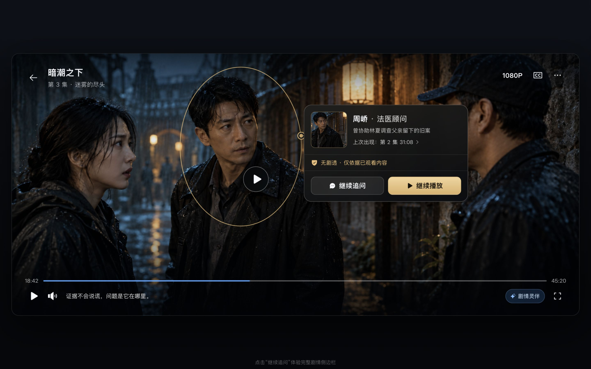
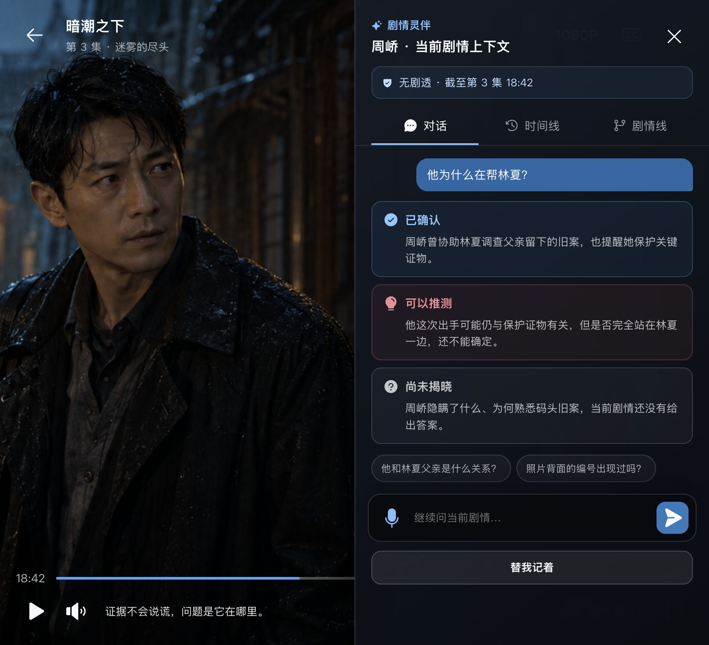

# 剧情灵伴demo

**让用户在“接不上剧情”的时刻，用一次简单操作恢复理解，再从原位置继续观看。**

剧情灵伴是一个进度感知的观看内 AI 剧情助手原型：基于用户正在观看的画面、人物和已观看进度，提供低打扰、可追问的上下文帮助。本仓库包含 React 交互 Demo、产品定位、体验规格、评测与灰度方案，以及设计验收材料。

> 当前版本是使用本地模拟剧情数据的可交互原型，尚未接入真实模型、视频流、字幕识别或剧情知识库。文档中的效果、指标和放量门槛均属于待验证设计。



## 解决什么问题

对于人物关系复杂、线索密集或时间线交错的连续剧，间隔追更、同时追多部剧或短暂分心，都可能让用户遇到理解断点：

- **看过但忘了**：“这个人之前出现过吗？”“他和主角是什么关系？”
- **看到了但没理解**：“他为什么突然帮她？”“这件事和前面有什么关联？”
- **作品尚未揭晓**：“他是真凶吗？”——此时需要明确边界，避免提前透露答案。

产品优先解决人物身份、人物关系及相关前情带来的理解断点。目标是减少用户组织背景、反复回看和离开播放器搜索的成本，帮助用户恢复理解并继续观看。

## 核心体验

**发现理解断点 → 暂停查看人物卡 → 一键继续追问 → 获得当前进度内的解释 → 返回原位置播放**

| 环节 | Demo 表达 |
| --- | --- |
| 暂停态 | 保留视频主画面，展示当前人物、已知关系和上次出现位置 |
| 继续追问 | 一键打开右侧面板，沿用当前人物与播放情境 |
| 对话 | 支持推荐问题和文字追问，区分“已确认 / 可以推测 / 尚未揭晓” |
| 时间线 | 展示与当前人物、事件有关的已观看节点 |
| 剧情线 | 查看相关线索与状态，隐藏未观看内容 |
| 返回播放 | 关闭面板后保留暂停位置，继续播放时给出反馈 |



## 产品原则与边界

- **懂此刻**：围绕当前画面、字幕和播放进度组织上下文，减少重复描述。
- **不剧透**：仅使用已观看范围内的信息，不能用未来剧情暗示答案。
- **低打扰、用户控制**：正常播放时保持安静，暂停不等于困惑，完整帮助由用户主动展开。
- **可相信**：区分事实、推测和未知；真实接入阶段，每条事实都需要可定位的依据。
- **能返回**：帮助结束后顺畅回到原播放位置。

本阶段不覆盖播放全程自动讲解、频繁主动弹出、未来剧情、角色扮演或角色形象与声音二次生成。时间线与剧情线用于展示扩展体验，基础价值评测优先聚焦人物、前情、有限追问和恢复播放。

## 验证思路

评测方案设计为三层：**离线能力门禁 → 受控用户实验 → 线上灰度实验**，主要对照平台已有的主动问答体验。

关注用户是否正确恢复理解、减少上下文描述、缩短恢复播放的时间，同时守住事实准确、观看进度、打扰和退出等边界。点击率或观看时长不能单独证明产品价值。

相关实验尚未执行，当前 Demo 不能证明真实模型的准确率、响应时延、剧透防护效果或业务收益。真实弱网、权限受限、超时与无结果恢复仍需接入接口后验证。

## 本地运行

需要 Node.js 20.19+ 或 22.12+。

```bash
cd demo
npm ci
npm run dev
```

终端会显示本地访问地址。

```bash
# 构建（生成 dist/client、dist/server 和部署配置）
npm run build

# 预览构建版本
npm run preview

# 检查静态资源服务与页面回退逻辑
npm run test:sites
```

技术栈：React、Vite、Phosphor Icons。依赖版本以 `demo/package-lock.json` 为准。

## 产品文档与项目结构

README 的产品介绍依据交付包内的三份文档整理：

- [用户问题与产品定位说明 V2](deliverables/用户问题与产品定位说明-V2.html)：目标用户、理解断点、优先场景和产品边界。
- [产品体验说明 V1](deliverables/产品体验说明-V1.html)：核心流程、上下文与回答契约、系统状态及研发交接要求。
- [评测与灰度方案 V1](deliverables/评测与灰度方案-V1.html)：对照设计、评测指标、灰度阶梯及回退条件。

HTML 文档下载后可直接用浏览器打开。

| 路径 | 内容 |
| --- | --- |
| `demo/src/` | React 界面与样式 |
| `demo/public/` | 演示素材 |
| `demo/dist/` | 可运行构建版本 |
| `demo/audit/screenshots/` | 5 张核心流程截图 |
| `demo/audit/comparisons/` | 设计稿与实现对照图 |
| `demo/design-references/` | 原始设计参考图 |
| `demo/audit-report.md` | 交互与可访问性检查报告 |
| `demo/design-qa.md` | 设计验收记录 |
| `deliverables/` | 三份产品说明 HTML 文档 |
| `scripts/` | 产品体验说明 HTML 生成脚本 |
| `交付清单.md` | 原始交付清单 |
