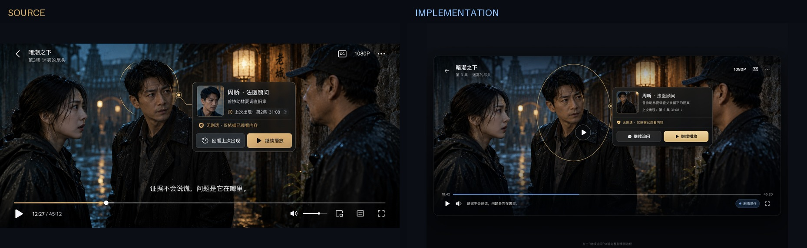
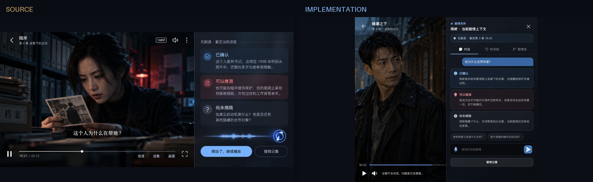

# 暗潮之下 AI 剧情灵伴 Demo — Design QA

## 结论

- 状态：通过本轮试运行验收
- 试运行评分：96/100（项目尚未完成真实用户样本校准，因此不作为正式交付评分）
- 阻断问题：0
- 高优先级问题：0
- 中优先级问题：0（发送按钮问题已修复并复验通过）

## 视觉对照

### 暂停态

- 保留第 2 稿的核心结构：视频仍是主画面、人物聚焦、角色关系卡、无剧透说明、继续播放。
- 按产品要求将原“回看上次出现”主操作替换为“继续追问”，并保留上次出现的时间定位信息。
- 实现版本增加了播放器控制区和剧情灵伴入口，属于 Demo 可操作性补充。

### 追问侧边栏

- 保留第 3 稿的右侧沉浸面板结构。
- 将信息分为“对话 / 时间线 / 剧情线”，避免把所有内容堆在同一视图。
- 回答明确区分“已确认 / 可以推测 / 尚未揭晓”，并持续显示当前无剧透边界。

## 已验证路径

1. 暂停视频后显示人物识别与关系卡。
2. 点击“继续追问”显示理解剧情的加载反馈，再打开侧边栏。
3. “对话 / 时间线 / 剧情线”三个标签均可切换。
4. 输入问题并发送，先显示回答中状态，再显示基于当前进度的回答。
5. 关闭侧边栏后可继续播放，并显示从 18:42 继续播放的反馈。
6. 浏览器日志无 error 或 warning。

## 状态覆盖

- 已覆盖：暂停、播放、侧栏关闭、加载、回答中、回答完成、长文本、侧栏滚动、窄屏重排。
- 不适用：登录、权限、真实数据缺失（本 Demo 使用本地模拟数据）。
- 未验证：真实弱网、真实模型超时、真实接口错误；当前只有本地错误态组件，没有接入真实接口。

## 验收证据

- `audit/screenshots/01-pause.jpg`
- `audit/screenshots/02-conversation.jpg`
- `audit/screenshots/03-timeline.jpg`
- `audit/screenshots/04-plot.jpg`
- `audit/screenshots/05-followup-answer.jpg`

